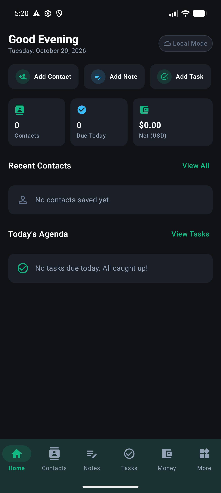
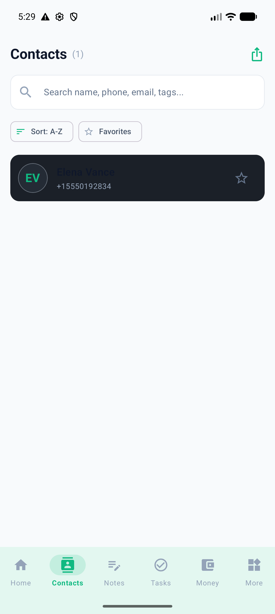
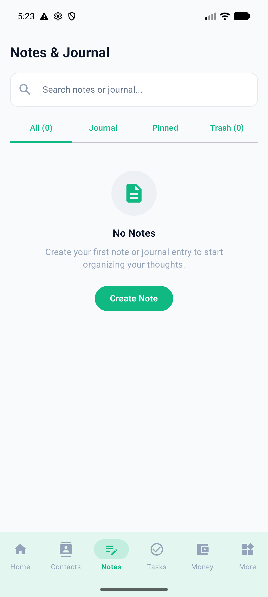
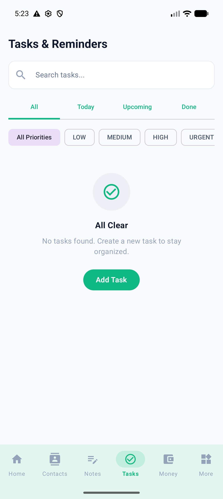
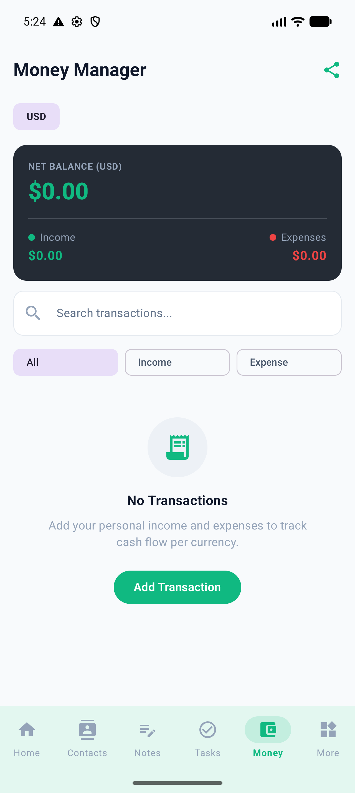
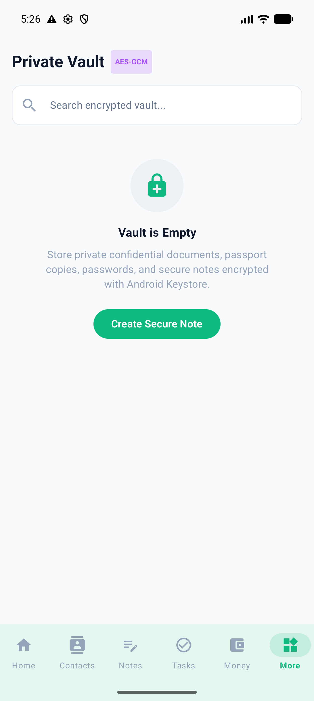
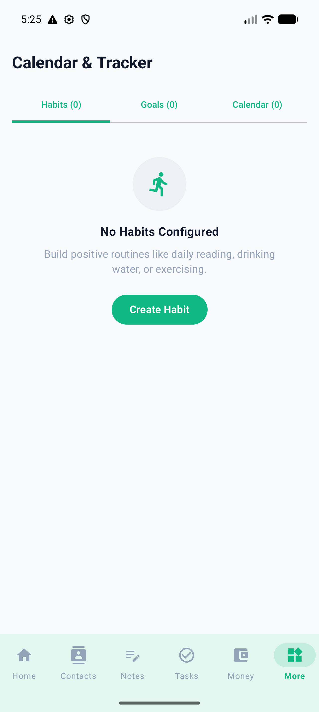
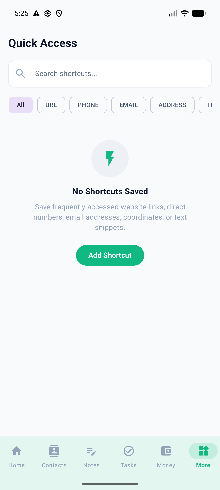
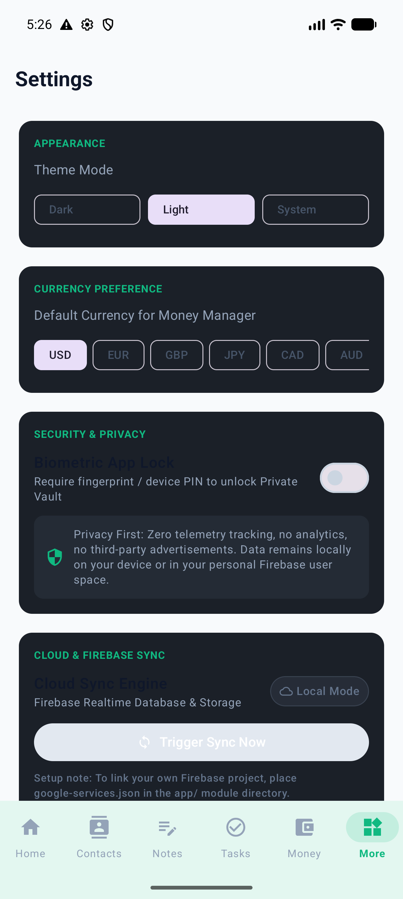

# MySpace Personal Hub

> **A privacy-first, local-first, zero-knowledge personal life management hub for Android.**

Built with **Modern Kotlin**, **Jetpack Compose (Material 3)**, **Room Database**, **Android Keystore AES-256-GCM**, and **PBKDF2-HMAC-SHA256 encrypted backups**.

---

## 🌟 Overview

**MySpace Personal Hub** brings together your essential daily tools into a unified, secure, and privacy-respecting application. Designed for complete offline autonomy, your data lives on your device first as the authoritative single source of truth, with optional, zero-knowledge encrypted cloud synchronization via Firebase Realtime Database.

---

## 📱 Core Modules

### 1. 🏠 Home Dashboard
- Real-time intelligent greeting with current date and dynamic daily metrics.
- High-priority task reminders and overdue alert flags.
- Pinned notes quick cards for immediate reference.
- Favorite contacts quick-actions (call, message, email).
- Today's habit streak progress and goals summary.

### 2. 👥 First-Class Personal Contacts Directory
- Full contact details: multiple phone numbers (Mobile, Work, Home, Custom), emails, addresses, birthdays, company/job title, custom tags, and personal notes.
- Instant search by name, phone, email, or tags.
- Alphabetical fast-scroll index.
- One-tap communication: initiate phone calls, SMS messages, and emails using Android native system intents.
- Address maps integration: open physical addresses directly in Google Maps.
- vCard (.vcf) import and export for effortless data migration.

### 3. 📝 Notes & Journal
- Rich note taking with titles, rich body text, timestamps, and custom tags.
- Note categorization and instant search.
- Pin important notes to the top of your list and dashboard.
- Mark favorites for quick filtering.

### 4.  Aufgaben & Reminders (Tasks)
- Comprehensive task management with titles, notes, due dates, and times.
- Four priority tiers: `Low`, `Medium`, `High`, `Urgent`.
- System-level notifications via `AlarmManager` and `NotificationHelper`.
- Automatic rescheduling across device reboots via `BootReceiver`.
- Filter by All, Pending, Completed, Overdue, and Priority.

### 5. 💰 Money Manager
- Personal income and expense tracking with multiple account types (Cash, Bank, Credit Card, Savings).
- Exact arithmetic calculations using `BigDecimal` — zero floating-point rounding errors.
- Multi-currency support (USD, EUR, GBP, JPY, CAD, AUD, INR) with isolated per-currency totals.
- Monthly budgets with visual progress indicators and spend warning thresholds.
- Filter and search by category, account, and date ranges.

### 6. 🔒 Private Vault
- Secure storage for confidential credentials, bank account details, and private notes.
- Hardware-backed **AES-256-GCM** encryption via `AndroidKeyStore`.
- Guarded by AndroidX **BiometricPrompt** (Fingerprint, 3D Face Unlock, or Device PIN).
- Zero plaintext exposure in memory or system logs.
- Automatic session locking when navigating away or backgrounding the app.

### 7. 📅 Calendar & Personal Tracker (Habits & Goals)
- Daily habit tracking with streak counters and completion logs.
- Idempotent daily check-ins preventing duplicate logs.
- Target goals with measurable progress bars and completion deadlines.
- Integrated calendar view connecting tasks, events, and habit history.

### 8. ⚡ Quick Access Shortcuts
- Rapid launcher for essential daily links: URLs, phone hotlines, street addresses, and copied text snippets.
- One-tap intent dispatch to web browser, dialer, and navigation apps.

### 9. ⚙️ Settings, Privacy & Encrypted Backup
- System / Dark / Light theme selector.
- Default currency configuration.
- Biometric security toggle.
- **Encrypted Local Backups**: Export and import complete database snapshots encrypted with **PBKDF2-HMAC-SHA256 (600,000 iterations)** and **AES-256-GCM**.
- Cloud Sync controls: switch seamlessly between pure Local Mode and Firebase Realtime Sync.

---

## 📸 Screenshots

| Home Dashboard | Contacts Directory | Notes & Journal |
| :---: | :---: | :---: |
|  |  |  |

| Tasks & Reminders | Money Manager | Private Vault Auth |
| :---: | :---: | :---: |
|  |  |  |

| Calendar & Habits | Quick Access Shortcuts | Settings & Backup |
| :---: | :---: | :---: |
|  |  |  |

---

## 🏗️ Technical Architecture

- **Pattern**: Clean Architecture + MVI/MVVM with unidirectional data flow.
- **UI Framework**: Jetpack Compose (100% declarative UI with Material 3 design tokens).
- **Local Database**: Room 2.8.5 with SQLite (Single Source of Truth).
- **Preferences**: Jetpack DataStore 1.1.7.
- **Cryptography**: `AndroidKeyStore` (AES-256-GCM) + `PBKDF2WithHmacSHA256` (600,000 rounds).
- **Background Tasks**: WorkManager 2.10.0 + AlarmManager exact alarms.
- **Cloud Sync**: Firebase Realtime Database 35.0.2 with safe local fallback.
- **Serialization**: Kotlinx Serialization 1.8.0.

For detailed architecture diagrams and data flows, see [docs/ARCHITECTURE.md](docs/ARCHITECTURE.md).

---

## 🚀 Getting Started & Building

### Prerequisites
- **Android Studio**: Ladybug / Meerkat (or newer)
- **JDK**: Java 21 (`jbr-21`)
- **Android SDK**: API 36 (minSdk 26, targetSdk 36)

### Build via Command Line
```bash
# 1. Set environment variables
export JAVA_HOME=/Users/xagor/Library/Java/JavaVirtualMachines/jbr-21.0.11/Contents/Home
export ANDROID_HOME=/Users/xagor/Library/Android/sdk

# 2. Run unit tests
./gradlew testDebugUnitTest

# 3. Assemble Debug APK
./gradlew assembleDebug
```

The compiled APK will be located at:
```
app/build/outputs/apk/debug/app-debug.apk
```

### Install onto Connected Emulator/Device
```bash
$ANDROID_HOME/platform-tools/adb install -r app/build/outputs/apk/debug/app-debug.apk
```

### Build via Android Studio
1. Open Android Studio.
2. Select **Open** and choose the `/Users/xagor/Desktop/personal apps` folder.
3. Wait for Gradle Sync to complete.
4. Select your connected device or emulator in the toolbar.
5. Click **Run 'app'** (green play button) or press `Shift + F10`.

---

## ☁️ Optional Firebase Cloud Sync Setup

By default, MySpace operates in **100% Local Mode** without requiring any cloud configuration. To optionally enable cross-device cloud sync:

1. Create a project in the [Firebase Console](https://console.firebase.google.com/).
2. Add an Android app with package name `com.example.myspacepersonalhub`.
3. Download `google-services.json` and place it in the `app/` directory.
4. Enable **Realtime Database** and **Anonymous Authentication** (or Email/Password).
5. Apply the secure database rules documented in [docs/FIREBASE_SETUP.md](docs/FIREBASE_SETUP.md).
6. Enable Cloud Sync in **App Settings**.

---

## 🔒 Security & Privacy

MySpace Personal Hub contains **zero third-party trackers, zero advertising SDKs, and zero telemetry**. For complete security specifications, threat models, and cryptographic parameters, refer to [docs/SECURITY.md](docs/SECURITY.md).

---

## 📄 License
Personal & Private Use. All rights reserved.
