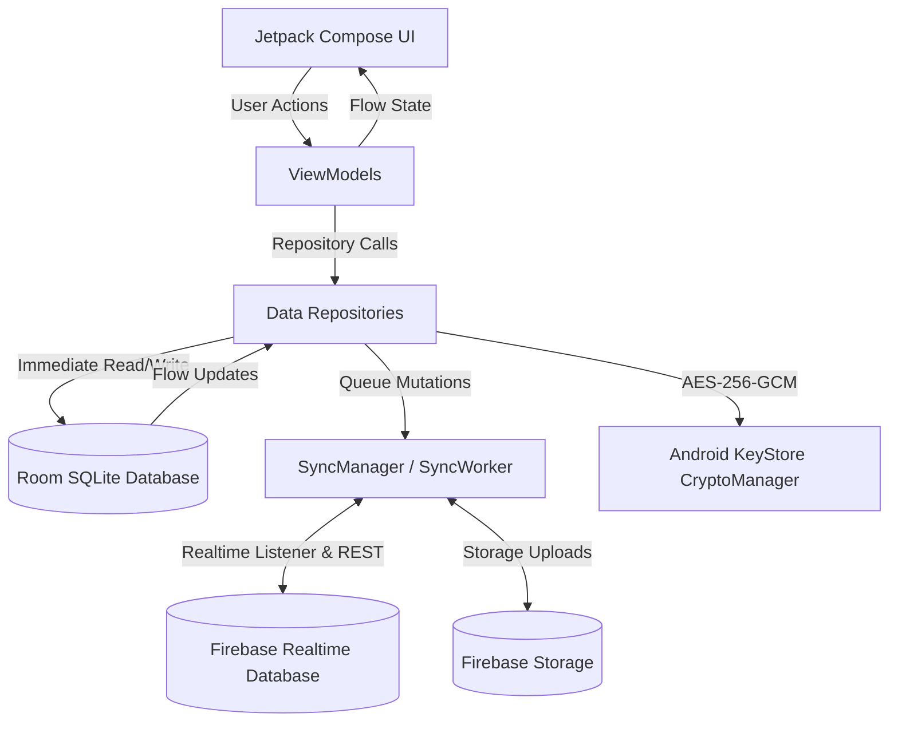

# MySpace Personal Hub — System Architecture

## 1. Overview
**MySpace Personal Hub** is an offline-first, private personal productivity hub for Android built using modern Android Jetpack libraries, Kotlin Coroutines, Jetpack Compose Material 3, Room, Android KeyStore authenticated encryption, and Firebase Realtime Database synchronization.

## 2. Core Architectural Principles
1. **Unidirectional Data Flow (UDF)**: ViewModels expose immutable `StateFlow<UiState>` instances consumed by Compose UI screens. Events and user intents flow upwards via typed function callbacks.
2. **Single Source of Truth (SSOT)**: Local SQLite database via Room serves as the immediate source of truth for all screens. The UI never directly calls remote APIs or blocks on cloud availability.
3. **Offline-First & Graceful Cloud Integration**: All CRUD operations write to the local Room database immediately with a `SyncState` indicator (`PENDING_CREATE`, `PENDING_UPDATE`, `PENDING_DELETE`, `SYNCED`). When network and Firebase credentials exist, `SyncManager` pushes mutations and reconciles remote updates.
4. **Zero-Knowledge Encryption for Private Vault**: Files and sensitive notes stored in the Private Vault are encrypted using hardware-backed AES-256-GCM via the `AndroidKeyStore`. Plaintext content is never stored in SQLite, shared preferences, or logs.
5. **Accurate Financial Arithmetic**: Monetary amounts are strictly stored as integer minor units (`Long`) alongside ISO 4217 currency codes. Floating point arithmetic is prohibited.



## 3. Package & Module Structure
The app adheres to a feature-oriented package layout designed for effortless multi-module extraction in future phases:

```
com.example.myspacepersonalhub
├── MySpaceApplication.kt          # Application lifecycle, dependency container & WorkManager init
├── MainActivity.kt                # Single FragmentActivity host, edge-to-edge, window security flags
├── navigation/
│   ├── Screen.kt                  # Typed screen routes and backstack destinations
│   └── NavigationHost.kt          # Backstack coordinator and screen router
├── core/
│   ├── model/                     # Domain enums, SyncState, PhoneNumber models
│   ├── database/
│   │   ├── MySpaceDatabase.kt     # Room database definition with type converters
│   │   ├── entity/                # Room entities (Contact, Note, Task, Transaction, etc.)
│   │   ├── dao/                   # Room Data Access Objects with Flow queries
│   │   └── converter/             # Type converters for JSON lists, phone numbers, enums
│   ├── datastore/
│   │   └── UserPreferencesRepository.kt # DataStore for theme, biometric toggle, default currency
│   ├── security/
│   │   ├── CryptoManager.kt       # Hardware-backed AES-256-GCM encryption/decryption
│   │   ├── BackupCrypto.kt        # PBKDF2WithHmacSHA256 + AES-GCM encrypted backup/restore
│   │   └── BiometricAuthManager.kt# AndroidX BiometricPrompt wrapper
│   ├── notifications/
│   │   ├── NotificationHelper.kt  # Notification channels, AlarmManager exact reminders
│   │   ├── ReminderReceiver.kt    # BroadcastReceiver for alarms
│   │   └── BootReceiver.kt        # Reschedules active reminders on reboot
│   ├── sync/
│   │   ├── SyncManager.kt         # Offline-first Firebase sync engine and status tracker
│   │   └── SyncWorker.kt          # WorkManager periodic background synchronization
│   └── util/
│       ├── CurrencyUtils.kt       # Integer minor units formatting and multi-currency balances
│       ├── IntentUtils.kt         # Safe dialer, email, maps, and URL scheme launchers
│       └── ContactVCardUtils.kt   # vCard 3.0 & JSON serialization utilities
├── data/repository/               # Repository layer isolating Room and remote sources
└── ui/
    ├── theme/                     # Premium Dark graphite (#101216) and Light Material 3 themes
    ├── components/                # Reusable UI widgets (Scaffold, SearchBar, Avatar, Dialogs)
    └── feature/
        ├── dashboard/             # Module 1: Home Dashboard with metrics and agenda
        ├── notes/                 # Module 2: Notes, Markdown, Journal & Trash
        ├── tasks/                 # Module 3: Tasks with due dates, alarms & recurrence
        ├── money/                 # Module 4: Money Manager with multi-currency totals
        ├── vault/                 # Module 5: Private Vault with Biometric Gate
        ├── tracker/               # Module 6: Calendar, Habit streaks & Goal progress
        ├── quickaccess/           # Module 7: Quick Access scheme-validated shortcuts
        ├── contacts/              # Module 7 (Core): First-Class Personal Contacts Directory
        └── settings/              # Settings, encrypted backup/restore, privacy policy
```

## 4. Key Subsystems

### 4.1 Personal Contacts Directory
- Full CRUD persistence via `ContactDao`
- Multiple labeled phone numbers (`Mobile`, `Home`, `Work`, `Other`) stored as structured JSON collections
- Deep Android intent integration (`ACTION_DIAL`, `ACTION_SENDTO`, geo maps `ACTION_VIEW`)
- Client-side export and import supporting both standard vCard 3.0 format and structured JSON
- Unicode and multi-language support (English, Armenian, Bengali, Arabic, etc.)

### 4.2 Private Vault
- Cryptographic keys generated inside Android KeyStore (`MySpaceVaultKey_v1`)
- Standard authenticated encryption: `AES/GCM/NoPadding` with 256-bit keys and 12-byte random IV
- In-memory biometric authentication gating via `BiometricPrompt`
- Automated locking on inactivity or user request

### 4.3 Cloud Sync Engine
- Realtime Database path layout: `users/{uid}/{collection}/{itemId}`
- Atomic per-item writes with server timestamps
- Local deletion tombstones (`deletedAt != null`) until confirmed removed from cloud
- Safe runtime check (`isFirebaseConfigured()`) ensuring 100% functionality even when Firebase credentials have not yet been provided.
